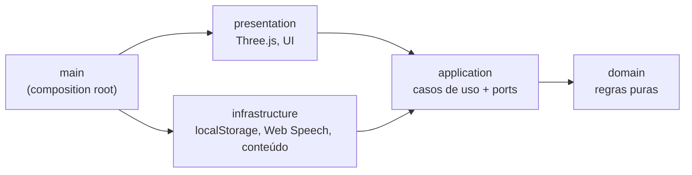

<div align="center">


# Lilo World

**Jogo educativo 3D, gratuito e de código aberto, para crianças autistas.**
Mundo aberto colorido, personagem para personalizar e missões curtas do dia a dia com comunicação visual (CAA).

[](https://github.com/ismael-figueiredo/lilo-world/actions/workflows/ci.yml)
[](LICENSE)
[](LICENSE-ASSETS.md)
[](#privacidade)

[Sobre](#sobre) · [Como jogar](#como-jogar) · [Rodar localmente](#rodar-localmente) · [Arquitetura](#arquitetura) · [Roadmap](#roadmap) · [Contribuir](CONTRIBUTING.md) · [English](#english-summary)

</div>

---

## Sobre

Muitas crianças autistas aprendem muito bem quando a informação chega de forma **visual e previsível**. A dificuldade costuma estar na comunicação, não na capacidade de aprender. O Lilo World usa aquilo de que elas já gostam (videogame, mundo aberto, personalização) como ponte para treinar situações reais: ir ao mercado, pegar ônibus, pedir um lanche, reconhecer emoções.

- **Projeto sem fins comerciais.** É sempre gratuito, sem anúncios e sem compras internas.
- **Feito para tablet, celular e computador.** Roda no navegador, sem instalar nada.
- **Feito junto com famílias e terapeutas.** Fonoaudiólogas, terapeutas ocupacionais, psicólogas e professoras são bem-vindas para sugerir missões.

O plano completo do projeto está em [docs/plano-jogo-autismo.md](docs/plano-jogo-autismo.md).

### Princípios de design

| Princípio                   | Como aparece no jogo                                                      |
| --------------------------- | ------------------------------------------------------------------------- |
| Comunicação visual primeiro | Pictogramas e voz antes do texto; o texto é sempre curto                  |
| Previsibilidade             | Toda missão segue **pedido → ação → comemoração**                         |
| Uma instrução por vez       | O mascote Lilo diz só o próximo passo e uma seta dourada mostra o caminho |
| Errar não pune              | Sem "game over" e sem som de erro: a dica só fica mais clara              |
| A criança escolhe           | Mundo aberto: ela decide para onde ir e o que vestir                      |
| Ajustável ao sensorial      | Movimentos suaves; o jogo respeita "reduzir movimento" do aparelho        |

## Como jogar

| Ação           | Tablet / celular                   | Computador           | Controle (USB ou Bluetooth)               |
| -------------- | ---------------------------------- | -------------------- | ----------------------------------------- |
| Andar          | Joystick (canto inferior esquerdo) | `W A S D` ou setas   | Analógico esquerdo ou direcional          |
| Correr         | Empurrar o joystick até a borda    | `Shift`              | Analógico até a borda, ou RB / RT         |
| Pular          | Botão ⤒                            | `Espaço`             | A (✕)                                     |
| Girar a câmera | Arrastar o dedo na tela            | Arrastar com o mouse | Analógico direito                         |
| Usar / entrar  | Botão amarelo que aparece perto    | `E` ou `Enter`       | B (◯) ou X (▢)                            |
| Menu           | Botão ☰ (canto superior direito)  | `Esc`                | Start; nos menus, direcional + A, B volta |

**Vários jogadores:** cada criança tem o próprio perfil (nome, progresso, ajustes e lugar no mundo). O jogo salva sozinho e continua de onde parou. Renomear, remover e mudar o limite de tempo ficam na **Área dos pais** (segure o botão por 3 segundos).

**Menu ☰:** mapa (toque num lugar e a seta mostra o caminho), meu progresso, ajustes (volumes, voz, cores suaves, reduzir movimento, câmera, minimapa, limite de tempo por sessão) e trocar jogador.

**Primeira missão:** siga a seta até o 🍎 **Mercado**, entre e pegue os ingredientes da receita do dia (cada vez é uma: bolo, salada, sopa…) e pague no caixa contando moedas. Com as moedas, vá até **🏠 Minha casa** e escolha cores, chapéus e acessórios no guarda-roupa. Nas **estações de Letras, Números e Moedas** (🔤 🔢 🪙) ela pratica no próprio ritmo: três acertos seguidos sobem o nível e cada nível novo dá uma figurinha para o álbum. As estrelas abrem os portais para novos mundos.

## Rodar localmente

Requisitos: **Node.js 22+** e **pnpm** (`corepack enable` já instala o pnpm).

```bash
git clone https://github.com/ismael-figueiredo/lilo-world.git
cd lilo-world
pnpm install
pnpm dev          # abre em http://localhost:5173
```

Para testar no tablet, rode `pnpm dev --host` e abra pelo IP do computador na mesma rede Wi-Fi.

### Scripts

| Comando              | O que faz                                                   |
| -------------------- | ----------------------------------------------------------- |
| `pnpm dev`           | Servidor de desenvolvimento com recarga automática          |
| `pnpm build`         | Typecheck e build de produção estático em `dist/`           |
| `pnpm preview`       | Serve o `dist/` localmente                                  |
| `pnpm lint`          | ESLint, incluindo as **regras de fronteira entre camadas**  |
| `pnpm typecheck`     | TypeScript em modo estrito                                  |
| `pnpm test`          | Testes unitários (Vitest)                                   |
| `pnpm test:coverage` | Testes com cobertura (mínimo de 80% em domínio e aplicação) |
| `pnpm check`         | Lint, typecheck e testes: o mesmo que a CI roda             |

### Publicar

O build gera **arquivos estáticos** (`dist/`) com caminhos relativos. Qualquer servidor web serve: Nginx ou Caddy numa VPS, GitHub Pages, Netlify ou uma pasta de hospedagem comum. Não há backend nem banco de dados.

## Arquitetura

Clean Architecture com **inversão de dependência**. As regras do jogo não sabem nada de Three.js, do navegador ou de onde os dados ficam salvos.



```
src/
├── domain/          # Moedas, missões (pedido → ação → dica), progresso, mundos. Zero dependências.
├── application/     # Casos de uso (StartMission, BuyWardrobeItem…) e ports (interfaces).
├── infrastructure/  # Implementações dos ports: localStorage, Web Speech API, catálogo de conteúdo.
├── presentation/    # Mundo 3D (Three.js), personagem, câmera, interface HTML.
└── main/            # Composition root: o único lugar que liga as implementações aos casos de uso.
```

As fronteiras são **garantidas pelo lint**: um `import` do domínio para a infraestrutura, ou do domínio para um pacote externo, quebra a CI. Mais detalhes em [docs/architecture.md](docs/architecture.md) e nas [decisões de arquitetura (ADRs)](docs/adr/).

**Stack:** TypeScript (strict) · Vite · Three.js · Vitest · ESLint (typescript-eslint + eslint-plugin-boundaries) · Prettier · Husky + lint-staged · commitlint · GitHub Actions

## Roadmap

- [x] **Fase 0:** repositório, licenças, arquitetura e CI
- [x] **Fase 1 (protótipo):** ilha 3D aberta, cidade, personagem animado e personalizável, missão do mercado com lista de figuras, moedas, estrelas e guarda-roupa
- [x] **v0.2, sprint 1:** perfis no mesmo aparelho, salvamento automático da sessão, menu, ajustes sensoriais e de som, mapa e minimapa, progresso, limite de tempo com aviso previsível, música e efeitos suaves
- [x] **v0.2, sprint 2:** 9 personagens animados (crianças, animais e robô) para escolher no cadastro e no guarda-roupa, com chapéus e acessórios que se ajustam a cada um
- [x] **v0.2, sprint 3:** mundo com modelos 3D CC0 (casas, lojas, carros, árvores, flores), placas 3D, personagem não entra no mar e jogo com controle (gamepad)
- [x] **v0.2, sprint 4a:** padaria (frases com CAA: **[eu quero] + [pão]**), ônibus (passos em ordem) e semáforo (esperar o boneco verde e atravessar na faixa, no mundo 3D)
- [x] **v0.2, sprint 4b:** estações de Letras, Números e Moedas com dificuldade adaptativa, álbum de figurinhas, alfabeto colecionável e caixa do mercado (pagar contando moedas)
- [x] **v0.2, sprint 4c:** missões que mudam a cada vez (9 receitas no mercado, lanches na padaria), bairro novo com avenida, praça com coreto e parquinho
- [x] **v0.2, sprint 4d:** mundo Natureza: acampamento com fazenda (sons dos animais), horta (plantar uma flor) e reciclagem (separar o lixo)
- [x] **v0.2, sprint 4e:** mundo Casa: escovar os dentes e lavar as mãos, escolher a roupa para o tempo e pôr a mesa
- [x] **v0.2, sprint 4f:** mundo Escola e Parque: arrumar a mochila, falar na escola com CAA (bom dia, pedir ajuda, pedir para ir ao banheiro) e esperar a vez no parque
- [x] **v0.2, sprint 4g:** mundo Emoções: reconhecer sentimentos em rostos e histórias e rotinas para ficar calmo (cantinho calmo)
- [x] **v0.2, sprint 4h:** mercado 3D por dentro: prateleiras com os itens do dia, carrinho e caixa
- [ ] **v0.2, próximos sprints:** ônibus em 3D, mais estações e mundo vivo (pessoas, carros, barcos, animais)
- [ ] **Fase 2:** missões do ônibus, do semáforo e da padaria (frases com CAA: **[eu quero] + [pão]**), painel de ajustes sensoriais, álbum de figurinhas, pictogramas ARASAAC, PWA offline
- [ ] **Fase 4:** painel para pais e terapeutas, fotos e figuras personalizadas, traduções

Quer ajudar numa dessas etapas? Veja as [issues](https://github.com/ismael-figueiredo/lilo-world/issues) e o [guia de contribuição](CONTRIBUTING.md).

## Privacidade

- **Nenhum dado sai do aparelho.** O progresso fica no armazenamento local do navegador.
- Não há contas, anúncios, rastreadores, analytics nem chat.
- Detalhes em [SECURITY.md](SECURITY.md).

## Licenças e créditos

- **Código:** [GPL-3.0](LICENSE). Qualquer versão derivada também precisa continuar aberta.
- **Arte, sons e textos do jogo:** [CC BY-NC-SA 4.0](LICENSE-ASSETS.md), sem uso comercial.
- **Modelos 3D:** personagens, casas, carros e plantas CC0 de Quaternius e Kenney (incluindo o RobotExpressive, de Tomás Laulhé). Lista completa em [CREDITS.md](CREDITS.md).

O Lilo World **apoia** a terapia e não a substitui. Combine com a família um tempo de tela e use o jogo junto com as metas definidas pelos profissionais que acompanham a criança.

---

## English summary

**Lilo World** is a free, open-source, non-commercial **3D open-world educational game for autistic children** (ages 5–12), running in any browser on tablets, phones and PCs. Kids explore a colorful low-poly island, customize their character and complete short, predictable everyday missions (grocery shopping, taking the bus, ordering at the bakery) with visual communication (AAC pictograms and voice). Mistakes never punish; hints just get clearer.

- **Run:** `pnpm install && pnpm dev`. **Check:** `pnpm check`. **Build:** `pnpm build` produces static files in `dist/`.
- **Architecture:** Clean Architecture with dependency inversion, with layer boundaries enforced by ESLint. See [docs/architecture.md](docs/architecture.md).
- **Privacy:** no accounts, no ads, no tracking; progress stays on the device.
- **License:** code GPL-3.0; art and content CC BY-NC-SA 4.0.
- **Contributing:** issues and PRs are welcome in Portuguese or English. See [CONTRIBUTING.md](CONTRIBUTING.md).
