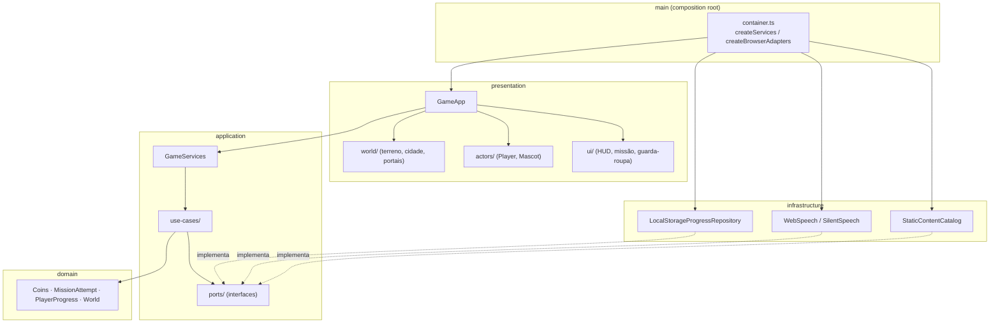
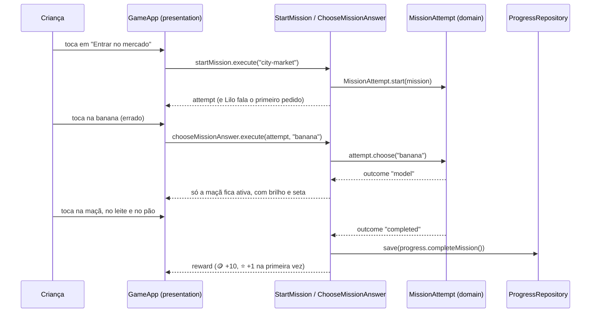

# Arquitetura

O Lilo World segue a **Clean Architecture** com **inversão de dependência**. As regras do jogo (moedas, dicas, desbloqueios) ficam isoladas da parte 3D, do navegador e do armazenamento. Assim dá para trocar o motor gráfico, guardar o progresso em outro lugar ou levar o jogo para outra plataforma sem reescrever as regras.

## Camadas



| Camada           | Responsabilidade                                                                                  | Pode importar                             |
| ---------------- | ------------------------------------------------------------------------------------------------- | ----------------------------------------- |
| `domain`         | Regras puras e imutáveis: moedas, missão (pedido → ação → dica), progresso, desbloqueio de mundos | só `domain`                               |
| `application`    | Casos de uso que orquestram o domínio e **ports** (interfaces) para o mundo externo               | `domain`                                  |
| `infrastructure` | Implementações dos ports: `localStorage`, Web Speech API, conteúdo estático                       | `application`, `domain`                   |
| `presentation`   | Three.js, câmera, personagem, interface HTML. Usa os casos de uso via `GameServices`              | `application`, `domain`, pacotes externos |
| `main`           | Composition root: liga as implementações concretas aos casos de uso                               | tudo                                      |

O ESLint aplica essas regras com `eslint-plugin-boundaries`. Além disso, `domain` e `application` não podem importar **nenhum** pacote externo.

## Inversão de dependência na prática

Os casos de uso dependem de **interfaces** declaradas na própria aplicação:

```ts
// application/ports/progress-repository.ts
export interface ProgressRepository {
  load(): Promise<PlayerProgress>;
  save(progress: PlayerProgress): Promise<void>;
}

// application/use-cases/buy-wardrobe-item.ts
export class BuyWardrobeItem {
  constructor(
    private readonly catalog: ContentCatalog,
    private readonly progress: ProgressRepository,
  ) {}
}
```

Só o `main/container.ts` sabe qual implementação usar:

```ts
createServices({
  catalog: new StaticContentCatalog(),
  progress: new LocalStorageProgressRepository(window.localStorage),
  speech: new WebSpeech(window.speechSynthesis, (text) => new SpeechSynthesisUtterance(text)),
});
```

Os testes passam `InMemoryProgressRepository` e `FakeSpeech` no lugar das implementações reais. Um painel de terapeuta poderia passar um catálogo editável, e uma versão nativa poderia passar um armazenamento de arquivo, sem mexer em nenhuma regra.

### Dados por criança

`GameServices` tem os casos de uso globais (perfis) e `forPlayer(profileId)`, que devolve um `PlayerServices` com repositórios **escopados** àquele perfil (chaves `lilo-world:v2:<perfil>:progress|settings|session`). Os casos de uso não sabem que existem vários perfis: o escopo é decidido só no composition root. Na primeira execução, a migração move o progresso da v1 para um perfil "Jogador".

Não há framework de injeção de dependência: os casos de uso recebem tudo pelo construtor, o que é explícito e fácil de seguir.

## Fluxo de uma missão



## Apresentação 3D

| Módulo                      | Papel                                                                                                                                                      |
| --------------------------- | ---------------------------------------------------------------------------------------------------------------------------------------------------------- |
| `world/terrain-shape.ts`    | Altura da ilha (simplex noise + áreas planas). Puro e testado                                                                                              |
| `world/collision.ts`        | Colisão do personagem (círculos e caixas) e da câmera. Puro e testado                                                                                      |
| `world/city.ts`, `props.ts` | Cidade low-poly: casas, mercado, padaria, ônibus, semáforo, fonte                                                                                          |
| `world/nature.ts`           | Árvores, pedras, grama e flores com `InstancedMesh` (leve no tablet)                                                                                       |
| `world/zones/`              | Lugares baixados e desenhados à parte. `zone-entries.ts` lista as zonas; `anchors.ts` guarda posições e ids, que o resto do jogo conhece sem baixar a zona |
| `world/portals.ts`          | Portais para os outros mundos, com cadeado e estrelas que faltam                                                                                           |
| `actors/player.ts`          | Personagem animado (andar, correr, pular, emotes) e acessórios presos aos ossos                                                                            |
| `engine/camera-rig.ts`      | Câmera em terceira pessoa suave, que não atravessa paredes                                                                                                 |
| `ui/*`                      | Interface em HTML/CSS sobre o canvas: nítida e acessível                                                                                                   |

Decisões detalhadas ficam nas [ADRs](adr/).
