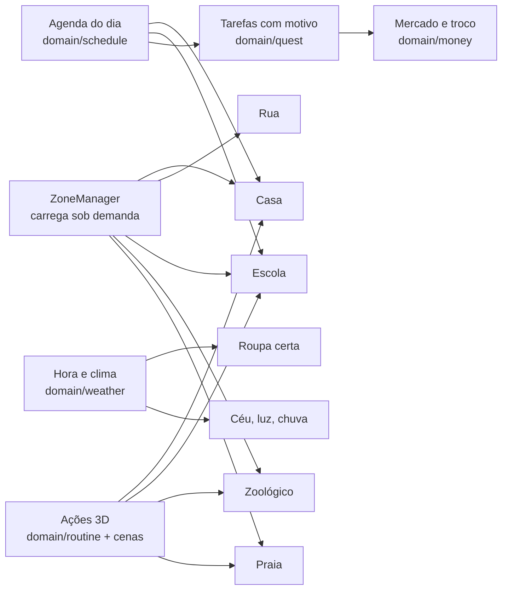

# Plano: um dia de vida real (v1)

Plano da grande mudança do Lilo World: sair de "mapa com estações e cartões" para **viver um dia inteiro**, da hora de acordar até dormir, em 3D. Complementa o [ROADMAP](../ROADMAP.md), que continua registrando o que já foi feito, e substitui as seções "Etapa 2", "Etapa 3" e "Mundo vivo" de lá.

**Como usar:** as camadas saem em ordem. Cada tarefa cabe em um commit ou PR, tem um critério de pronto e pode ser pedida pelo código (por exemplo, "faça a C4.3"). Ao concluir, marque `[x]` aqui.

## 1. A ideia em uma página

A criança acorda na casa do personagem. O dia tem uma agenda em figuras e **cada passo é feito no mundo 3D**, não em um cartão:

| Bloco do dia | O que acontece                                                                                                                   |
| ------------ | -------------------------------------------------------------------------------------------------------------------------------- |
| **Manhã**    | Acordar, ver o tempo pela janela, escolher a roupa, comer, escovar os dentes, arrumar a mochila                                  |
| **Escola**   | Ponto de ônibus, viagem animada, sala de aula (português, matemática, conhecimentos gerais), recreio, educação física, volta     |
| **Tarde**    | Almoço: alguém da casa cozinha, falta algo, a criança vai ao mercado com lista e dinheiro, traz o troco. Depois, lazer à escolha |
| **Lazer**    | Parque, zoológico ou praia, de ônibus, com desafios próprios                                                                     |
| **Noite**    | Jantar, banho, pijama, escovar os dentes, dormir. O dia vira e fica salvo no álbum                                               |

### Princípios desta mudança

1. **Mostrar antes de explicar.** Se dá para animar em 3D, anima-se. Cartão só onde ele é a melhor forma (CAA, lista de compras).
2. **Sem relógio apressando.** O dia avança quando a criança termina um passo, nunca por tempo real. Noite e dia são previsíveis.
3. **O mundo tem motivo.** Ir ao mercado existe porque falta algo em casa; o casaco existe porque está frio; cumprimentar existe porque alguém responde.
4. **Nada dá a resposta.** O que é pedido por voz não aparece escrito quando a escrita entrega a resposta.
5. **Leve primeiro.** Só carrega o lugar onde a criança está.
6. **Continuam valendo:** uma instrução por vez, errar não pune, alvos de 88 px ou mais, ajustes sensoriais, nada de dados fora do aparelho, nunca perder saves.

## 2. O que o teste e o código mostraram

| Tema                  | Situação hoje                                                                                                                                                                                                                              | Consequência                                                                      |
| --------------------- | ------------------------------------------------------------------------------------------------------------------------------------------------------------------------------------------------------------------------------------------ | --------------------------------------------------------------------------------- |
| **Resposta entregue** | `wordFirstLetter` monta o pedido `Com qual letra começa rato?`, e o mesmo texto é falado e escrito no painel e no balão do Lilo. A figura vem sozinha, mas a palavra escrita está logo abaixo. O teste atual só cobre a figura das missões | Precisa separar o que é falado do que é escrito, e testar isso em todo o conteúdo |
| **Calçadas**          | Calçada de 3 m com abrigo, placa e postes dentro dela. A placa do ônibus fica no meio da largura, e as placas de dois postes têm colisão só no centro                                                                                      | Criar faixa de mobiliário e um teste de corredor livre                            |
| **Peso**              | O download é modesto (JS 907 kB, 245 kB comprimido; 31 GLB, 1,9 MB). O problema é montar **tudo de uma vez**: 1.134 malhas, 260 materiais, 70 texturas e cerca de 2,9 milhões de triângulos na cena                                        | Dividir em zonas é mais importante que comprimir                                  |
| **Avatares**          | 9 modelos, 235 a 497 kB cada. Só o robô tem expressões; só ele tem dança e joinha                                                                                                                                                          | Sentimentos e rotinas pedem um personagem novo                                    |
| **Céu**               | `Sky` é fixo, com sol e cor únicos                                                                                                                                                                                                         | Dia, noite e clima são novos                                                      |
| **Sessão**            | Limite padrão de 10 minutos. Salva só a posição                                                                                                                                                                                            | Um dia inteiro não cabe em 10 minutos: o dia precisa ser salvo                    |
| **Controle**          | ▢ usa, ✕ pula, ◯ volta, △ menu. Pular não serve para nada no jogo                                                                                                                                                                          | Trocar pelo padrão de console e dar função real aos botões                        |
| **Sentimentos**       | Emoji e texto abstrato em um mundo separado                                                                                                                                                                                                | Refazer como cenas animadas dentro do dia                                         |
| **Testes**            | Bugs do teste de 30/10: botão Pronto fora da tela, plano do dia não salvo, placar que pune quem recebe ajuda, figurinha que não corresponde ao jogado                                                                                      | Entram na camada 0 ou são resolvidos pela nova agenda                             |

## 3. Decisões

Tomadas neste plano. Diga se alguma estiver errada, de preferência antes da camada indicada.

| #   | Decisão                                                                                                                                                                             | Por quê                                                          | Afeta |
| --- | ----------------------------------------------------------------------------------------------------------------------------------------------------------------------------------- | ---------------------------------------------------------------- | ----- |
| D1  | **Criança personalizável** como padrão: tom de pele, cabelo, cor do cabelo, olhos, gênero visual ou neutro. Os 9 avatares atuais viram fantasias e os saves mantêm o que escolheram | Identificação. Fantasia ainda agrada quem gosta de bicho ou robô | C3    |
| D2  | **Tempo por etapas**: cada bloco do dia tem fases fixas (manhã, meio-dia, tarde, noite) que mudam ao concluir passos                                                                | Previsibilidade e nenhuma pressão                                | C5    |
| D3  | **Uma sessão é um bloco do dia.** Com 10 minutos a criança faz cerca de um bloco; o dia fica salvo e continua na próxima vez                                                        | Mantém o limite de tempo sem cortar o dia                        | C4    |
| D4  | **Dia seguinte** começa quando a criança dorme no jogo, não pelo relógio do aparelho. O adulto pode pular blocos                                                                    | Funciona para quem joga pouco ou muito                           | C4    |
| D5  | **Dois tipos de dinheiro.** Moedas douradas seguem como prêmio. Reais de brinquedo (cédulas e moedas) são da casa, usados em compras reais e têm troco devolvido                    | Não misturar prêmio com matemática do dinheiro                   | C8    |
| D6  | **Quem cuida da casa** é uma pessoa adulta escolhida na criação do perfil (mãe, pai, avó, avô, tia, tio). O adulto da família pode mudar                                            | Famílias são diferentes                                          | C3    |
| D7  | **Lugares longe são zonas** com carregamento próprio, ligadas por ônibus ou porta, em vez de aumentar a ilha                                                                        | O mundo cresce sem pesar. A viagem de ônibus vira parte do jogo  | C2    |
| D8  | **Sem portais e sem estrelas travando lugares.** O mundo Emoções some; o cantinho calmo vai para casa. As estações saem da rua e viram "Estudar"                                    | Já era o novo rumo do roadmap, e a rua deixa de ser um menu      | C4/C6 |
| D9  | **Pular só existe onde tem sentido** (pátio, quadra, praia). Fora disso, o botão vira cumprimentar                                                                                  | Pular não serve para nada, e cumprimentar ensina                 | C1    |
| D10 | **Assets só CC0** ou feitos para o projeto. Mixamo fica de fora porque o repositório é aberto e os arquivos ficariam redistribuíveis                                                | Mantém a licença simples                                         | Todas |
| D11 | **Texto falado por ids** (`phrases`). Por enquanto a voz sintetizada lê tudo; a gravação só depois que o núcleo estiver pronto                                                      | Trocar a voz não mexe no conteúdo                                | C0    |
| D12 | **Conteúdo sensível passa por fono/TO** antes de ir para crianças: sentimentos, higiene, segurança na rua e no mar                                                                  | O público pede revisão profissional. Hoje é proposta             | C11   |

## 4. Peças novas

| Peça                   | Onde                             | Papel                                                                              |
| ---------------------- | -------------------------------- | ---------------------------------------------------------------------------------- |
| **Agenda do dia**      | `domain/schedule/`               | Blocos e passos, o que já foi feito, o que vem agora. Pura, testada e salva        |
| **Zonas**              | `presentation/world/zones/`      | Cada lugar monta, atualiza e descarta os próprios objetos, com `import()` dinâmico |
| **Interação no mundo** | `presentation/world/interact/`   | "Chegue perto, aperte ✕, veja a animação", com objeto em destaque                  |
| **Cenas**              | `presentation/scenes/`           | Pequenas sequências com câmera e personagens (acordar, comer, entrar no ônibus)    |
| **Tarefas**            | `domain/quest/`                  | Cadeia com motivo: falta tomate → lista → mercado → troco → cozinhar               |
| **Dinheiro**           | `domain/money/`                  | Valores em centavos, preço, pagamento, troco                                       |
| **Tempo e clima**      | `domain/weather/`                | Fase do dia e clima sorteado de forma previsível; roupa que combina                |
| **Frases**             | `infrastructure/catalog/phrases` | Id, texto falado, texto escrito. Depois recebe o áudio gravado                     |
| **Minijogos**          | `presentation/minigames/`        | Basquete, futebol e afins com a mesma interface de início, fim e ajustes           |

### Metas de desempenho

Referência: tablet comum. Medido em 30/10/2026, antes e depois da C2: chamadas de desenho de 795 para 422, triângulos na cena de 2,95 para 1,43 milhão, JS inicial de 248 para 238 kB, com a vegetação como maior custo. Falta medir em tablet real.

| Medida                  | Meta                                                                                                  |
| ----------------------- | ----------------------------------------------------------------------------------------------------- |
| Até a casa aparecer     | Até 3 s em Wi-Fi comum                                                                                |
| Download antes de jogar | Até 2 MB, com JS inicial até 300 kB comprimido                                                        |
| Cada zona nova          | Até 1,5 MB, com cache depois da primeira visita                                                       |
| Na tela, por zona       | Até 150 chamadas de desenho e 300 mil triângulos em zonas novas; a rua hoje está em 422 e 1,43 milhão |
| Quadros por segundo     | 30 ou mais, com qualidade automática                                                                  |

## 5. Camadas e tarefas

Dependências principais: C0 → C1 e C2 → C3 → C4. Depois disso, C5 a C8 seguem em ordem, e C9 a C13 podem trocar de lugar. C14 fecha o jogo.

### C0. Consertar o que está quebrado

Objetivo: base confiável antes da mudança grande.

- [x] **C0.1 Registrar o trabalho atual.** Fazer commit do currículo que está pendente. Pronto: `pnpm check` e `pnpm build` passam e o `git status` fica limpo.
- [x] **C0.2 Separar fala e escrita.** `prompt` passa a ter `spoken` e `written`, e o balão do Lilo obedece. Pronto: "Com qual letra começa rato?" é falado, e na tela aparece só a figura e "Com qual letra começa?".
- [x] **C0.3 Auditoria de respostas entregues.** Revisar as 13 habilidades e as 16 missões e anotar o que cada uma ensina (ouvir, ler, associar). Pronto: tabela em `docs/` e correções feitas.
- [x] **C0.4 Teste que impede a volta do erro.** Um teste percorre todos os geradores e missões. Pronto: falha se o texto escrito contém a resposta quando o objetivo não é copiar.
- [x] **C0.5 Frases por id.** Criar `phrases` e migrar pedidos, elogios e dicas. Pronto: nenhum texto falado solto no código de apresentação.
- [x] **C0.6 Ajuda sem tirar a tarefa.** Ajuda em `Levar` mostra só a primeira peça, e a contagem da ajuda considera a criança ativa. Pronto: criança no meio da contagem nunca perde as peças.
- [x] **C0.7 Placar gentil.** Ajuda e demonstração não aparecem como erro. Pronto: a tela final mostra o que foi feito, sem "1 de 4".
- [x] **C0.8 Figurinhas certas.** Figurinha ligada à habilidade jogada. Pronto: "Conta até 10" só vem depois de contar até 10.
- [x] **C0.9 Dificuldade em degraus.** Sem saltos de 1 para 5 e sem repetir a mesma resposta três vezes. Pronto: teste com semente nos geradores.
- [x] **C0.10 Atividade em celular em pé.** Peças em grade e Pronto sempre visível. Pronto: conferido em 375×812 e 812×375.
- [x] **C0.11 Detalhes do teste.** Resposta em rodada encerrada ignorada, bolinhas completas no fim, nomes para leitor de tela nos cartões, botão da estação anterior escondido durante a caminhada.

### C1. Controles de console

Objetivo: uma criança joga sem pensar nos botões.

| Controle PS | Xbox | Toque         | Teclado  | Função                                           |
| ----------- | ---- | ------------- | -------- | ------------------------------------------------ |
| ✕           | A    | Botão amarelo | E, Enter | Ação principal e confirmar                       |
| ◯           | B    | Botão ✕       | Esc      | Voltar e cancelar                                |
| ▢           | X    | Botão 👋      | Q        | Cumprimentar (ou pular em pátio, quadra e praia) |
| △           | Y    | Botão 📅      | Tab      | Agenda do dia                                    |
| Options     | Menu | Botão ☰      | P        | Menu                                             |
| L1          | LB   | Botão 🧸      | C        | Preciso de uma pausa (cantinho calmo)            |
| R2          | RT   | Automático    | Shift    | Correr, se não estiver no modo calmo             |

- [x] **C1.1 Novo mapa de botões.** Atualizar `gamepad.ts`, `padGlyphs`, `input.ts` e `pad-focus`. Pronto: testes de intenção atualizados e ✕ confirma em todos os painéis.
- [x] **C1.2 Dicas sempre certas.** `pad-hints` mostra o que cada botão faz no momento. Pronto: a dica muda ao chegar perto de algo.
- [x] **C1.3 Controles de toque iguais.** Mesmos botões e posições estáveis. Pronto: alvos de 88 px ou mais em celular deitado e em pé.
- [x] **C1.4 Cumprimentar.** Personagem acena, NPC perto responde. Pronto: acenar perto de alguém gera resposta falada e animada; longe, só acena.
- [x] **C1.5 Pulo por lugar.** Zonas dizem se o pulo existe. Pronto: na rua não pula; na quadra sim.
- [x] **C1.6 Botão de pausa.** L1 abre o cantinho calmo de qualquer lugar. Pronto: ao sair, volta exatamente onde estava.
- [ ] **C1.7 Teste com controle físico.** Pendência antiga. Pronto: roteiro feito por você em DualSense ou Xbox, com problemas anotados.

### C2. Zonas e carregamento leve

Objetivo: o jogo cresce sem pesar.

- [x] **C2.1 Medição.** Painel de dev com FPS, chamadas de desenho, triângulos e memória, além de script de tamanho do build. Pronto: números atuais anotados e metas calibradas.
- [x] **C2.2 `ZoneManager`.** Montar, atualizar, descartar (geometria, material e textura) e trocar zona atrás do fade. Pronto: dez trocas seguidas sem crescer a memória.
- [x] **C2.3 Carga por zona.** `WorldAssets` passa a pedir só o manifesto da zona. Pronto: abrir a casa baixa apenas os modelos da casa.
- [x] **C2.4 Código dividido.** `import()` dinâmico por zona. Pronto: JS inicial dentro da meta.
- [x] **C2.5 Aliviar a rua.** Natureza reduzida e peças fixas da cidade unidas. Pronto: 1,43 milhão de triângulos, menos da metade dos 2,95 milhões de antes. A rua ainda carrega no início: virar zona fica na C4.14.
- [x] **C2.6 Tela de carregamento.** Barra simples com Lilo, mesma para todas as zonas. Pronto: nunca há tela preta sem aviso.
- [x] **C2.7 Qualidade automática.** Sombras, densidade e resolução ajustadas pelo FPS. Pronto: mantém 30 FPS ou mais no tablet de referência.
- [x] **C2.8 Cache offline.** Service worker com arquivos versionados. Pronto: segunda visita abre sem rede.

### C3. Personagem e pessoas

Objetivo: uma criança que representa quem joga e que sabe fazer as ações do dia.

- [x] **C3.1 Prova de personagem.** Universal Base Characters descartado sem baixar: adulto, musculoso e com pele só na versão paga. Lis, Sam, Ana e Téo também não são crianças. Decisão aprovada: criança própria montada por código, com 0 kB de modelo.
- [x] **C3.2 Pipeline do personagem.** Não é mais necessário: a criança não tem arquivo de modelo, então não há manifesto, otimização nem crédito novo.
- [x] **C3.3 Criador de criança.** Pele, cabelo, cor do cabelo, olhos, gênero visual e neutro, com prévia 3D. Pronto: escolhas salvas no perfil, com uso completo por controle e toque.
- [x] **C3.4 Migração de saves.** Avatares antigos viram fantasias. Pronto: perfil antigo abre igual, sem perder nada, e com teste.
- [x] **C3.5 Roupas por camada.** Pijama, roupa de casa, uniforme, casaco, capa de chuva, bermuda, roupa de banho. Pronto: trocar roupa sem recarregar o modelo e sem atravessar o corpo.
- [x] **C3.6 Biblioteca de ações.** Sentar, deitar, levantar, comer, beber, escovar, lavar, pegar, carregar, arremessar, chutar, nadar. Pronto: animações feitas por código, conferidas por poses congeladas no jogo.
- [x] **C3.7 Rostos que mudam.** Olhos e boca trocados por textura. Pronto: feliz, triste, bravo, com medo, surpreso e calmo legíveis à distância de jogo.
- [x] **C3.8 Família e NPCs.** Adulto da casa, professora, colegas, caixa, motorista, gerados a partir do mesmo personagem. Pronto: 8 pessoas diferentes sem novo arquivo pesado.
- [x] **C3.9 Comportamento de NPC.** Andar por rota, parar, olhar para a criança, acenar. Pronto: lógica pura com teste.

### C4. Casa: o jogo começa aqui

Objetivo: primeira experiência nova e completa.

- [x] **C4.1 Agenda do dia (domínio).** Blocos, passos, avanço e salvamento. Pronto: testada, retomando no passo certo.
- [x] **C4.2 Agenda na tela.** Figuras "agora → depois", no botão △. Pronto: entende-se sem ler.
- [x] **C4.3 Casa caminhável.** Sala, quarto, banheiro, cozinha e porta da rua, com colisão e câmera de interior. Pronto: andar por tudo sem a câmera atravessar paredes.
- [x] **C4.4 Interação no mundo.** Objeto brilha, botão ✕ aparece, personagem anda até lá e faz a ação. Pronto: mesma mecânica em cama, armário, pia, mesa.
- [x] **C4.5 Cena de acordar.** Início do jogo: quarto, luz entrando, levantar. Pronto: o jogo inicia na cama em vez da rua.
- [x] **C4.6 Comer.** Sentar à mesa, escolher o que comer, comer. Pronto: alimento some aos poucos.
- [x] **C4.7 Escovar os dentes.** Passos no banheiro com animação e espuma. Pronto: substitui a missão de sequência em cartão.
- [x] **C4.8 Tomar banho e lavar as mãos.** Com roupa preservada, sem nudez, com cortina ou box opaco. Feito no jogo; a revisão de fono/TO do critério D12 ainda está pendente.
- [x] **C4.9 Guarda-roupa e espelho.** Abrir armário, escolher, ver no espelho. Pronto: substitui o painel antigo.
- [x] **C4.10 Arrumar a mochila.** Pegar itens do dia no quarto. Pronto: lista vem do que a agenda tem.
- [x] **C4.11 Fim dos portais.** Remover portais, estrelas de bloqueio e mundos no mapa, mantendo os saves. Pronto: nada travado por estrelas e teste de migração.
- [x] **C4.12 Bloco como sessão.** Ao fim de um bloco, parada natural e salvamento. Pronto: limite de 10 minutos nunca corta uma ação no meio.
- [x] **C4.13 Primeira execução.** Criar criança → acordar → aprender andar e ✕ dentro de casa. Pronto: criança nova chega à mesa sem ajuda de texto.
- [x] **C4.14 Rua sob demanda.** Ilha e cidade viram zona, e o jogo abre só com a casa. Pronto: a casa aparece sem baixar os modelos da rua.

### C5. Hora, clima e roupa

Objetivo: o mundo muda e a criança responde a isso.

- [x] **C5.1 Fases do dia.** Domínio ligado à agenda. Pronto: testado.
- [x] **C5.2 Céu dinâmico.** Manhã, meio-dia, entardecer, noite, com luz, cor e sombra. Pronto: transição suave, com luzes de janela e postes à noite.
- [x] **C5.3 Clima do dia.** Sol, nublado, chuva, vento, frio. Sorteio com semente e adulto pode fixar. Pronto: testado.
- [x] **C5.4 Efeitos leves.** Chuva, poças, folhas ao vento, respiração no frio (galhos parados por enquanto). Pronto: dentro da meta de desempenho e desligado em "Reduzir movimento".
- [x] **C5.5 Olhar pela janela.** Cena mostra o tempo. Pronto: a criança sabe o tempo sem texto.
- [x] **C5.6 Roupa combina com o tempo.** Regras de roupa. Pronto: escolher errado gera conselho gentil, sem punir, e a roupa pode ser trocada.
- [x] **C5.7 Consequência visível.** Com capa, a chuva não incomoda; sem casaco, o personagem encolhe de frio. Pronto: animação, sem perda de pontos.
- [x] **C5.8 Sons do tempo.** Chuva, vento, pássaros de dia, grilos à noite. Pronto: ligados aos volumes dos ajustes.

### C6. Estudar

Objetivo: gramática, matemática e conhecimentos gerais dentro da rotina.

- [x] **C6.1 Lugar de estudo.** Escrivaninha em casa abre as atividades, também fora do passo do dia, e as estações saíram da rua. A carteira da escola fica para quando a sala de aula virar um lugar 3D (C10); a mesa já não depende da casa para mostrar o conteúdo.
- [x] **C6.2 Sessão de estudo.** `planSession` alimenta o passo "Estudar" da agenda: três atividades curtas, uma de cada trilha sempre que dá, depois recompensa.
- [x] **C6.3 Mostrar em 3D.** Mesa e quadro vistos pelos olhos da criança: objetos de verdade para contar, pratos para somar e comparar, coisas que saem de verdade ao subtrair, relógio, dinheiro de brinquedo e cesta que enche enquanto a criança leva as peças. O painel guarda só a versão para leitor de tela. Bichos e coisas sem modelo aparecem como figura sobre a mesa.
- [x] **C6.4 Trilha de gramática.** Vogais, sílabas, rimas, plural, artigos, frase simples, com geradores e sem resposta entregue. Áudio depende da gravação; a ordem pede revisão de fono (D12).
- [x] **C6.5 Trilha de matemática.** Sequência numérica, maior e menor, somar, subtrair, formas, horas simples e dinheiro, com progressão por pré-requisitos.
- [x] **C6.6 Trilha de conhecimentos gerais.** Corpo, animais, plantas, tempo, profissões, Brasil e cuidados, com catálogo de perguntas. O conteúdo é proposta e passa pela revisão do D12; perguntas sobre comida saudável ficaram de fora de propósito, por causa da seletividade alimentar.
- [x] **C6.7 Interações novas.** Ligar, ordenar, separar em grupos e completar, todas feitas de botões, então funcionam com toque e teclado. O teste com controle físico segue pendente.
- [x] **C6.8 Painel do adulto.** Habilidades por trilha, com prioridade, e dificuldade por trilha: com calma encurta as atividades, mais desafio abre habilidades sem esperar as anteriores.

### C7. Rua viva e calçadas livres

Objetivo: a rua parece real, é segura e não atrapalha.

- [x] **C7.1 Faixa de mobiliário.** Postes, placas e abrigos ficam na borda ou fora da calçada, numa lista só (`street-layout.ts`) usada para desenhar e colidir. O abrigo do ônibus foi para trás da calçada e a placa para o meio-fio.
- [x] **C7.2 Teste de corredor.** O teste percorre as calçadas com as colisões da mobília e falha abaixo de 1,6 m. As duas ruas laterais têm calçada de 1,5 m; nelas o teste exige que nada fique no caminho.
- [x] **C7.3 Seguidor de rotas.** Lógica pura e testada em `domain/city/route.ts`.
- [x] **C7.4 Carros.** Quatro carros dão a volta nos quarteirões do sul, sempre no mesmo sentido. Param no semáforo, na faixa, para a criança e para outros carros; testes cobrem quem entra na frente em cima da hora. A rua norte e o sentido contrário continuam sem trânsito, por causa do ônibus parado.
- [x] **C7.5 Pedestres.** Duas pessoas novas andam pelas calçadas, esperam no meio-fio e atravessam na faixa sem parar no meio. Respondem ao ▢ como os vizinhos.
- [x] **C7.6 Pássaros e animais.** Bando e pombos instanciados, que dormem à noite; pombos voam quando a criança chega perto. Cachorro passeia e abana o rabo; gato fica no banco. Modelos simples feitos em código.
- [x] **C7.7 Som de rua.** Motor conforme a distância do carro mais próximo, buzina rara e distante, e um volume próprio nos Ajustes para os sons da rua e do tempo.
- [x] **C7.8 Modo calmo na rua.** `worldActivity` deixa um carro, menos pássaros, motor mais baixo e nenhuma buzina.
- [x] **C7.9 Vizinhança.** Placa curta no portão de casa para o mercado e o ônibus. Da porta ao ponto, pela faixa, dá cerca de 7 s de caminhada.
- [x] **C7.10 Seta perto da criança.** Seta no chão junto dos pés, apontando em linha reta para o objetivo. Some perto dele.

### C8. Almoço, mercado e troco

Objetivo: a primeira tarefa completa, com motivo e consequência.

- [x] **C8.1 Tarefas (domínio).** `domain/errand`: etapas pedir, comprar, trazer e cozinhar, salvas dentro do dia.
- [x] **C8.2 Dinheiro (domínio).** `domain/money`: tudo em centavos, testado.
- [x] **C8.3 Faltou algo.** Geladeira abre, mostra o que tem e um lugar vazio, e o adulto faz a lista. A receita muda a cada dia.
- [x] **C8.4 Lista e carteira.** Lista em figuras e dinheiro do adulto, consultáveis na agenda (△).
- [x] **C8.5 Mercado caminhável.** A criança anda no mercado com o carrinho, entre prateleira do fundo e prateleira baixa, e pega o item no lugar dele. Sem tarefa do dia, o mercado continua sendo a missão antiga de cartões.
- [x] **C8.6 Preços e pagamento.** Etiquetas nas prateleiras e caixa com cédulas e moedas no painel. Três níveis, valor exato, troco e centavos, seguindo `math.cash.2` e `math.cash.3`.
- [x] **C8.7 Troco.** A criança confere quanto voltou. Nos níveis com valores inteiros, bolinhas mostram o que foi pago e o que o preço levou.
- [x] **C8.8 Voltar e entregar.** Guarda as compras na geladeira, entrega o troco e o adulto agradece.
- [x] **C8.9 Cozinhar junto.** Lavar, adulto corta, mexer, servir. Comida na mesa e os dois almoçam, o que conclui o passo Almoço da agenda.
- [x] **C8.10 Padaria.** No dia do sanduíche o pão é pedido com cartões na porta da padaria e pago do mesmo jeito. Ainda não há interior nem atendente.

### C9. Ônibus e escola

Objetivo: ir à escola de forma animada e viver um dia de aula.

- [x] **C9.1 Rota do ônibus.** `domain/city/bus.ts`: vem pela rua, para na placa, espera e vai embora. O ônibus parado na rua saiu; a pista norte continua sem carros.
- [x] **C9.2 Pegar o ônibus.** Esperar no ponto, deixar descer, entrar, passar o cartão e sentar. Quem desce sai pela porta caminhando.
- [x] **C9.3 Viagem animada.** Interior com colegas sentados, janela com paisagem e botão de parada. Dura 26 s; o adulto pode escolher viagem curta nos Ajustes. A escola carrega durante a viagem.
- [x] **C9.4 Escola completa.** Prédio caminhável com entrada, corredor, sala, banheiro, refeitório e biblioteca. Pátio e quadra estão desenhados, e a saída para eles vem na C10.
- [x] **C9.5 Rotina da escola.** Agenda própria, salva a cada etapa, em `domain/school`. Fechar o jogo no meio retoma pela viagem de ônibus, na etapa em que parou.
- [x] **C9.6 Aula.** Professora no quadro e duas atividades da C6 na carteira da criança.
- [x] **C9.7 Pedir ajuda e pedir para ir ao banheiro.** Cartões "Eu preciso..." com a professora, e qualquer pedido é certo. As missões antigas de cartão seguem no mapa da ilha.
- [x] **C9.8 Lanche e refeitório.** A fila anda sozinha, a criança escolhe o lanche e senta com um colega.
- [x] **C9.9 Volta para casa.** Volta curta, direto à porta de casa, e o dia segue para o almoço. Não há tarefas próprias da escola na agenda ainda; o passo Estudar faz esse papel.

### C10. Recreio, esportes e brincadeiras

Objetivo: lazer de verdade, com regras simples e colegas.

- [x] **C10.1 Base de minijogo.** `PlayController`: regra em figura, poucas rodadas e fim feliz, sem derrota. Com "Reduzir movimento" a mira fica mais lenta.
- [x] **C10.2 Basquete.** Um botão para em uma barra, e cada erro alarga a cesta: a quinta tentativa sempre entra.
- [x] **C10.3 Futebol.** Tabela com um colega e chute ao gol.
- [x] **C10.4 Esconde-esconde.** Colegas ficam atrás de arbustos baixos, sempre aparecendo, e acenam ao serem achados.
- [x] **C10.5 Amarelinha.** Oito casas numeradas no chão, contadas a cada pulo.
- [x] **C10.6 Pega-bola e corda.** Cada uma no seu lugar do pátio, à escolha. A corda ainda não é desenhada: é só o pulo contado.
- [x] **C10.7 Brinquedos do pátio.** Balanço, escorregador e gangorra, sempre esperando a vez. A criança ainda usa uma pose sentada em vez de animação própria de cada brinquedo. A missão de cartão segue na ilha.
- [x] **C10.8 Convidar um colega.** Colegas dizem sim, depois ou não, e o último chamado sempre aceita.
- [x] **C10.9 Educação física.** Nos dias pares, aquecimento e um esporte, antes do recreio.

### C11. Sentimentos, do jeito certo

Objetivo: entender o que se sente ao ver acontecer, não ao ler um emoji. Todo este conteúdo passa pela revisão do D12.

Ordem de ensino proposta: **ver a cena → notar corpo e rosto → dar nome → saber o que ajuda.**

- [ ] **C11.1 Roteiro com profissional.** Proposta escrita em [roteiro-sentimentos.md](roteiro-sentimentos.md), com as perguntas para a revisão. **Falta a aprovação de fono ou TO.**
- [x] **C11.2 Sistema de cenas.** `FeelingsController`: cena curta, repetível, ligada por um ajuste do adulto e desligada por padrão até a revisão.
- [ ] **C11.3 Cenas do dia a dia.** As 12 cenas têm texto e rosto, e acontecem no pátio ao fim do recreio. Falta animar cada uma: hoje só o rosto do colega muda, sem o objeto da cena em 3D nem a ação.
- [x] **C11.4 Nomear com duas opções.** Dois colegas lado a lado com rostos diferentes e duas palavras, sem emoji e sem pontos.
- [x] **C11.5 O que ajuda.** A criança escolhe e vê o resultado no rosto e na frase.
- [x] **C11.6 Como eu estou.** Cinco figuras na agenda; guarda 14 registros, só no aparelho, visíveis na área dos pais.
- [x] **C11.7 Cantinho calmo.** Almofada, ursinho e luz suave na sala, com três respirações. Em casa abre por L1; fora de casa L1 segue sendo a pausa calma.
- [ ] **C11.8 Remover o mundo antigo.** Fica para depois da aprovação do roteiro, para a criança não ficar sem o conteúdo de sentimentos.

### C12. Zoológico

Objetivo: passeio com descoberta.

- [x] **C12.1 Modelos de animais.** Plano B: 10 animais feitos em código, sem download e sem licença de terceiros. Respiram, comem e dormem, mas não andam.
- [x] **C12.2 Zona do zoológico.** Caminho circular com 10 recintos, lanchonete e banheiro no meio. Um teste percorre o parque e confirma que tudo é alcançável. Lanchonete e banheiro só respondem com uma fala.
- [x] **C12.3 Viagem e entrada.** Na parte livre do dia, o ponto oferece o passeio. Mesmo ônibus da escola e ingresso pago no caixa da C8.
- [x] **C12.4 Conhecer o animal.** Fala curta de cada um, ver comer e ver dormir. Ouvir é só a voz descrevendo: não há som gravado de animal.
- [x] **C12.5 Caderno de animais.** Figurinha no álbum na primeira visita a cada animal.
- [x] **C12.6 Desafios.** O que come, onde vive e quantas patas, em frente ao recinto. A pergunta do som ficou de fora até haver áudio.
- [x] **C12.7 Alimentar com o tratador.** A criança escolhe a comida e o animal come. O tratador é só uma voz, sem personagem.
- [x] **C12.8 Regras do passeio.** Três regras em figuras na entrada, e o adulto da casa caminha junto.

### C13. Praia

Objetivo: lazer livre com segurança.

- [x] **C13.1 Zona da praia.** Areia, mar, quiosque, posto de guarda-vidas e guarda-sóis, feitos em código. O guarda-vidas é só o posto, sem personagem.
- [x] **C13.2 Preparar o passeio.** Bolsa da praia no ponto de ônibus e passeio só com sol ou nublado. A roupa de banho entra na chegada, e a roupa da criança volta na saída.
- [x] **C13.3 Castelo de areia.** Três torres com balde e um enfeite à escolha. O resultado vira figurinha no álbum: ainda não é uma foto real, e a construção é guiada, não livre.
- [x] **C13.4 Bola e frescobol.** Quatro rebatidas com o adulto. Sem bola 3D e sem frescobol separado.
- [x] **C13.5 Conchas.** Oito conchas de verdade na areia, contadas por cor. Separar por forma ficou de fora.
- [ ] **C13.6 Água com segurança.** Feito no jogo: bandeira verde ou amarela, sempre com o adulto e nunca além das boias, o que um teste garante. **Falta a revisão de fono/TO do D12.**
- [x] **C13.7 Quiosque.** Pedido com cartões e pagamento com troco, como no mercado.

### C14. Noite e fechamento

Objetivo: fechar o dia e preparar o jogo para crianças reais.

- [x] **C14.1 Rotina da noite.** Jantar, banho, dentes, pijama e cama, com as cenas da C4.
- [x] **C14.2 Dormir e história.** Quatro histórias curtas, uma frase por toque, e a luz que escurece devagar. A criança pode só dormir.
- [x] **C14.3 Lembrança do dia.** Os últimos 7 dias no álbum, em figuras do que foi feito. Não são fotos reais da cena.
- [x] **C14.4 Recompensas.** Quatro enfeites para o quarto, pagos com moedas douradas do jogo, sem compras reais. As roupas já existiam.
- [x] **C14.5 Área dos adultos.** Atrás do botão de segurar: habilidades por trilha, blocos, tempo, clima, viagem, sentimentos e humor. Metas próprias do adulto não foram criadas.
- [x] **C14.6 Roteiro de gravação.** `pnpm voice:script` gera [roteiro-gravacao.csv](roteiro-gravacao.csv). As frases das atividades e das missões ficam fora, porque são geradas com o conteúdo.
- [ ] **C14.7 Trocar a voz.** O código está pronto: `public/voice/manifest.json` liga cada texto a um arquivo, e o que falta segue na voz sintetizada. **Falta gravar os áudios.**
- [ ] **C14.8 Teste com crianças.** Roteiro em [teste-com-criancas.md](teste-com-criancas.md). **Falta fazer as sessões, depois da revisão profissional.**
- [ ] **C14.9 Revisão final.** `pnpm check`, `pnpm build`, saves antigos e documentação em dia. **Falta medir desempenho em tablet real e revisar acessibilidade com controle físico e leitor de tela.**

## 6. Riscos

| Risco                                              | Resposta                                                                               |
| -------------------------------------------------- | -------------------------------------------------------------------------------------- |
| O personagem base não parece criança ou é pesado   | Resolvido na C3.1: criança própria feita por código, sem arquivo de modelo             |
| Faltam animações CC0 para ações específicas        | Animar por código as simples; aceitar ações com câmera mais aberta                     |
| Faltam animais CC0 consistentes                    | Validar em C12.1 antes de começar a zona. O zoológico pode trocar de lugar com a praia |
| O escopo cresce sem nunca chegar a um jogo inteiro | Ao fim de C4, C8 e C10 existe um jogo jogável, que pode ser mostrado a crianças        |
| Mundo novo cansa ou sobrecarrega                   | Modo calmo, redução de movimento e botão de pausa valem desde a primeira zona          |
| Conteúdo sensível mal explicado                    | Revisão profissional antes de chegar às crianças (D12)                                 |
| Saves quebrarem                                    | Migrações sempre somam e têm teste; nenhuma tarefa apaga dados                         |

## 7. Entregas

| Marco               | Fim das camadas | O que dá para jogar                                    |
| ------------------- | --------------- | ------------------------------------------------------ |
| **Base firme**      | C0 a C2         | Jogo atual, sem os bugs, com novo controle e mais leve |
| **Minha manhã**     | C3 a C5         | Criar a criança, acordar, tempo, roupa, café, dentes   |
| **Meu dia em casa** | C6 a C8         | Estudar, rua viva, mercado, troco e almoço             |
| **Minha escola**    | C9 a C10        | Ônibus, aula, recreio e esportes                       |
| **Meu mundo**       | C11 a C13       | Sentimentos, zoológico e praia                         |
| **Versão 1**        | C14             | Dia completo, voz gravada e teste com crianças         |

## Fontes

- [Quaternius: Universal Base Characters](https://quaternius.itch.io/universal-base-characters): CC0, com penteados combináveis e cores de pele nos arquivos fonte. A quantidade de penteados diverge entre páginas e será conferida na C3.1.
- [Quaternius: 5 low poly animals (OpenGameArt)](https://opengameart.org/content/5-low-poly-animals): CC0, candidato inicial para a C12.1.
